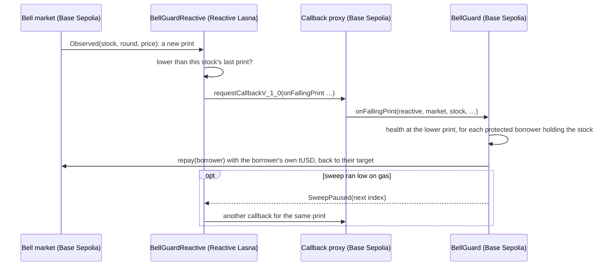

# Bell Guard

**Reactive deleveraging for tokenized-stock loans.** Bell, a lending market for Coinbase's tokenized stocks on Base,
never liquidates on a single price print. Bell Guard turns that one print of warning into protection: a Reactive Network
contract sees the falling print and calls back to Base, where the guard pays down the borrower's debt before the
confirming print can land.

Built for the [Reactive Omni Buildathon](https://dorahacks.io/hackathon/reactive-omni-buildathon), track
**Every Second Counts** (Base Sepolia + Reactive Lasna).

- **Dashboard (live feed, latency, races):** https://superphant.github.io/bell-guard/
- **Demo video (2:36):** https://superphant.github.io/bell-guard/demo.mp4
- **Every measured loop, with transaction links:** [docs/latency.md](docs/latency.md)
- **Reactive contract:** [`0x7520A38E…0A44` on Reactscan](https://lasna.reactscan.net/address/0x7520A38E2e73c6650aD6Cd8109C2c72d73260A44)
- **Guard:** [`0x47FfAB78…A40F` on Basescan](https://sepolia.basescan.org/address/0x47FfAB786f1E3fcFf63F91Ed3687390da539A40F)

Measured on-chain so far: the full loop (falling print on Base → Reactive Lasna → guard running on Base) takes
**1.0–1.8 s, median 1.6 s**. In sandbox crashes, the protected borrower survived every race in which the confirming
print came later than the loop, and its unprotected twin lost **$520** to the liquidation bonus each time.

## The problem

Stocks gap. A tokenized TSLA can open 15% lower on a Monday, and the next oracle round can follow seconds later.
[Bell](https://github.com/SuperPhant/bell) handles a single bad print safely: borrowing power uses the lower of a stock's
last two prints and liquidations use the higher, so a falling print has to be confirmed by the next one before anyone
can be liquidated. A real crash is confirmed quickly, though, and then a liquidator takes the bonus (7.5% of the debt
it repays, for TSLA).

Between the warning and the confirmation, the borrower's worst case is already known: the position valued at the lower
print. That is the window to act in, and it can be a few seconds long. Nobody watches a loan 24/5 to act inside it. A
keeper bot can, but it is off-chain infrastructure someone has to run, fund and trust. Bell Guard is that watcher,
built from contracts only.

## How it works



1. **A falling print (Base Sepolia).** A Bell market records a new feed round and emits `Observed(token, roundId,
   answer)`. Nobody can be liquidated on it yet.
2. **[BellGuardReactive](contracts/src/BellGuardReactive.sol) (Reactive Lasna)** keeps the last print of every
   (market, stock) pair it watches. When a new print is lower, it requests a callback to Base carrying the print, the
   origin block and its own Lasna block. Rises and flat prints only update its record.
3. **[BellGuard](contracts/src/BellGuard.sol) (Base Sepolia)** values each protected position that holds the fallen
   stock at the lower of each stock's last two prints, times Bell's liquidation thresholds: its *pessimistic health*,
   the health factor the confirming print will make real. Below the borrower's trigger it repays debt until the
   pessimistic health is back at the borrower's target, pulling exactly that much tUSD from the borrower's wallet,
   within the budget they set. It never holds funds between calls.

A borrower opts in with `approve(guard, budget)` on the market's tUSD and
`protect(market, triggerHf, targetHf, budget)` on the guard (or the form on the dashboard).

### What the reactive contract does

- **Stateful filtering.** It remembers the last print per market and stock and wakes the guard only on falling prints
  at least `minDropBps` deep. Rising and flat prints never cost a callback.
- **Continuation.** It also subscribes to the guard's own `SweepPaused` event. If protecting every borrower would not
  fit in one callback, the guard stops with gas to spare and says where; the reactive contract immediately requests
  another callback for the same print. A full guard (32 borrowers, all needing a rescue) is handled in two callbacks
  instead of one that would run out of gas and rescue nobody
  ([test](contracts/test/BellGuard.t.sol), `test_bigSweepPausesAndReactiveContinuesIt`).
- **Selective subscriptions.** It watches every stock of the sandbox market, and only TSLA, MSTR and NVDA on the live
  market, through topic filters.
- **Self-describing loops.** Each callback carries the origin block, the Lasna block and the Lasna timestamp, and the
  guard logs its own millisecond time, so every loop can be measured from the chain alone.

### Why Reactive, and not a keeper bot

Without Reactive, the guard would need an off-chain keeper: a server that watches every Bell print around the clock,
keeps a funded hot key, and has to be up at the moment a stock gaps. It is one more thing to run, secure and trust, and
when it is down nobody notices until a borrower is liquidated. With Reactive the watching is a contract: the
subscription is the trigger, the state (the last print of every stock) lives on-chain, and the network delivers the
callback. Measured cost: about 0.014 REACT per print on Lasna (0.27 for the first 20 prints, rises included) and a
fraction of a cent of gas per callback on Base Sepolia. Measured speed: 1.0–1.8 s from the falling print to the
repayment. Nothing to run.

## Measured latency

A loop starts in the Base Sepolia block where the falling print was recorded and ends in the Base Sepolia block where
the guard ran. Both ends come from Base's [BaseTime predeploy](https://github.com/base/base-std)
(`0x4200…0030`, millisecond block timestamps, 200 ms blocks), so both are on one clock and exact to the block.

**9 loops by submission: median 1.6 s, 90th percentile 1.8 s, fastest 1.0 s (5 blocks), slowest 1.8 s (9 blocks).**
[docs/latency.md](docs/latency.md) lists every loop with its Base and Lasna transactions; a
[workflow](.github/workflows/report.yml) refreshes it hourly, including loops on the live market.

Lasna's block timestamps are whole seconds and ran about 1.4 s behind Base's clock when we compared them, so the report
splits the loop by blocks rather than subtracting timestamps from two different chains.

## Races against the confirming print

[CrashLab](contracts/src/sandbox/CrashLab.sol) runs a separate Bell market whose TSLA feed it controls, with the live
market's tokens, rates and TSLA risk parameters. [`ops/src/race.ts`](ops/src/race.ts) opens two identical borrowers at
Bell's limit (100 TSLA, $13,876 of debt each), applies a −16% slide confirmed by two prints, protects one of them
(trigger 1.25, target 1.40), then publishes a −15% gap and, after a chosen delay, the confirming print followed in the
same transaction by liquidation attempts on both.

| Confirming print after the gap | Guard loop | Protected borrower | Unprotected twin |
|---|---|---|---|
| 20.0 s (filmed for the demo video) | 1.6 s | safe; $4,145.52 repaid from its own wallet | liquidated, lost $520 |
| 4.8 s | 1.6 s | safe; $4,145.51 repaid | liquidated, lost $520 |
| 1.6 s | 1.0 s | safe; $4,145.51 repaid | liquidated, lost $520 |
| 0.4 s | 1.8 s | liquidated: the guard arrived 1.4 s too late | liquidated, lost $520 |

The guard wins whenever the next print comes later than the loop, about 1–2 s. That is the case for Reactive Omni:
with ~1 s Reactive blocks and 200 ms Base blocks, the whole loop fits inside the gap between two feed rounds. On the
previous Reactive version, ~7 s blocks would have made a single hop longer than this entire loop.

### One full loop, transaction by transaction (the first race)

| Step | Chain | Transaction |
|---|---|---|
| Gap print, TSLA −15% (the warning) | Base Sepolia, block 61633920 | [`0x2fe7dd91…`](https://sepolia.basescan.org/tx/0x2fe7dd91268d2236e6681bdf6700d8de49690286175a1f4e4899fccd7ed22584) |
| `react()`: falling print, callback requested | Reactive Lasna, block 8878097 | [`0x0959b738…`](https://lasna.reactscan.net/tx/0x0959b738b3e161a686841901046422ee9749427379c7bec248ca903ff95d0414) |
| `onFallingPrint`: $4,145.51 repaid, pessimistic health 0.98 → 1.40 | Base Sepolia, block 61633928 (+1.6 s) | [`0xafdd6236…`](https://sepolia.basescan.org/tx/0xafdd62367827bfb5fe9934deff16e0784f9af56bfd7e8ac774d2ea9707fbde89) |
| Confirming print, liquidation attempts: protected reverts, unprotected liquidated | Base Sepolia, block 61633944 | [`0x374eb2c9…`](https://sepolia.basescan.org/tx/0x374eb2c956a99e821a086526c327a0d9b303d43b2ec93a08974af01affb2d8ab) |

The fastest loop, in a race won at a 1.6 s gap:
[`0xe2f22338…`](https://sepolia.basescan.org/tx/0xe2f223389de3ae5081f82fb2080d5cf164ba136cc0353ed747e05cb5585e0ed8) (gap print) →
[`0x1b445ddf…`](https://lasna.reactscan.net/tx/0x1b445ddf1c7267037d9667bf3977e7bdd019f3fc4d9fc995856f747895614a1c) (Lasna) →
[`0x0fd66a17…`](https://sepolia.basescan.org/tx/0x0fd66a176988dc684da3494558a101235d7fcd3ca1c12a9c279a5b71bb826eed) (guard, +1.0 s) →
[`0xf2bbf74d…`](https://sepolia.basescan.org/tx/0xf2bbf74d5e42b6faf73deff1eb358113f62088de83cfb87599a6abe48b60a6f0) (confirming print).

## On the live market

The reactive contract also watches the [live Bell market](https://github.com/SuperPhant/bell), which Bell's keeper feeds
with real Chainlink prints of Coinbase's tokenized stocks (relayed every two hours while US stocks trade). A protected
position there ([`0x68E3…E425`](https://sepolia.basescan.org/address/0x68E3AF39a68265DC28961350f43c3ebA964CE425):
TSLA, MSTR and NVDA, borrowed to Bell's limit) has its trigger just under its health, so ordinary down moves make the
guard act. Every falling print of those stocks is a measured loop on real prices; the dashboard shows them as they land.

## Deployments

| Contract | Network | Address |
|---|---|---|
| BellGuardReactive | Reactive Lasna (5318007) | [`0x7520A38E2e73c6650aD6Cd8109C2c72d73260A44`](https://lasna.reactscan.net/address/0x7520A38E2e73c6650aD6Cd8109C2c72d73260A44) |
| BellGuard | Base Sepolia (84532) | [`0x47FfAB786f1E3fcFf63F91Ed3687390da539A40F`](https://sepolia.basescan.org/address/0x47FfAB786f1E3fcFf63F91Ed3687390da539A40F) |
| CrashLab (sandbox) | Base Sepolia | [`0xCfef4E51ab35c5A05EE7633dFe8C7130c286ead6`](https://sepolia.basescan.org/address/0xCfef4E51ab35c5A05EE7633dFe8C7130c286ead6) |
| Sandbox Bell market | Base Sepolia | [`0x9D016aCe2A6F4a55dee414026F36bc283a67bD24`](https://sepolia.basescan.org/address/0x9D016aCe2A6F4a55dee414026F36bc283a67bD24) |
| Sandbox TSLA feed hub | Base Sepolia | [`0x4EA2d0727c846233be0941C09af25e2EE5423A36`](https://sepolia.basescan.org/address/0x4EA2d0727c846233be0941C09af25e2EE5423A36) |
| Live Bell market (watched) | Base Sepolia | [`0x6d9f3290AAEBF3A207D181250548865BA138039C`](https://sepolia.basescan.org/address/0x6d9f3290AAEBF3A207D181250548865BA138039C) |
| Callback proxy (Reactive's) | Base Sepolia | [`0x476F44b11F5C942c58f4c8E3d0300E5710743585`](https://sepolia.basescan.org/address/0x476F44b11F5C942c58f4c8E3d0300E5710743585) |

The contracts this project deployed are verified on [Sourcify](https://sourcify.dev) (exact match). Addresses are also
in [contracts/deployments](contracts/deployments).

## Run it

Contracts use [Foundry](https://getfoundry.sh) (v1.10.0). The tests run against a Base Sepolia fork, because Bell's
tokens are Base B20 precompile tokens and the guard reads the BaseTime predeploy. A mock stands in for Reactive's
system contract, and the tests drive the whole loop: `Observed` log → `react()` → callback payload with the reactive
contract's address injected → guard.

```sh
git clone --recursive https://github.com/SuperPhant/bell-guard && cd bell-guard/contracts
forge test --fork-url https://sepolia.base.org
```

Deploy:

```sh
# 1. Base Sepolia: guard, sandbox market and CrashLab. REACTIVE_ADDRESS is the reactive contract's future address
#    (the Lasna deployer's next nonce), because the guard stores it immutably.
REACTIVE_ADDRESS=0x… DEPLOYER_KEY=0x… forge script script/DeployBase.s.sol --rpc-url base_sepolia --broadcast --slow

# 2. Reactive Lasna: watch the sandbox market (any stock) and TSLA, MSTR and NVDA on the live market.
forge create src/BellGuardReactive.sol:BellGuardReactive --rpc-url https://lasna-rpc.rnk.dev/ --private-key $KEY \
  --broadcast --value 4ether \
  --constructor-args 84532 $GUARD 0 "[$SANDBOX,$LIVE,$LIVE,$LIVE]" "[0x0000000000000000000000000000000000000000,$TSLA,$MSTR,$NVDA]"
```

Races and reports (Node 20+):

```sh
cd ops && npm ci
DEPLOYER_KEY=0x… npx tsx src/race.ts --delay 1500   # one sandbox race; appends to results/races.json
npx tsx src/report.ts                               # docs/latency.md and the dashboard data
```

Lasna's endpoints are not reachable from every network. [`lasna.yml`](.github/workflows/lasna.yml) runs any Lasna
command from GitHub Actions; that is how the reactive contract was deployed and verified.

## Repository

| Path | What |
|---|---|
| [contracts/src/BellGuardReactive.sol](contracts/src/BellGuardReactive.sol) | Reactive contract (Lasna) |
| [contracts/src/BellGuard.sol](contracts/src/BellGuard.sol) | Callback contract (Base) |
| [contracts/src/sandbox](contracts/src/sandbox) | CrashLab and the borrower accounts it drives |
| [contracts/test/BellGuard.t.sol](contracts/test/BellGuard.t.sol) | Fork tests: the full loop, access control, budgets, isolation, continuation |
| [ops/src](ops/src) | Race runner, live-position setup, latency report |
| [docs](docs) | Dashboard (GitHub Pages) and the latency report |
| contracts/lib/bell | Bell, as a dependency (git submodule) |

## Limits and next steps

- Testnet only and not audited.
- The guard repays from the borrower's spare tUSD. A borrower without spare cash is not helped yet; selling a slice of
  the collateral through a DEX in the same callback is the natural next step once tokenized stocks have deep on-chain
  liquidity.
- If the confirming print lands within the loop time (about 1–2 s), the guard loses the race, as the third race shows.
- One guard protects up to 32 borrowers per market; more would mean more guards, each with its own reactive contract.
- The pessimistic health assumes the next print confirms the lower one. A further fall is another falling print and
  another loop.

## Prior work and AI use

- **Bell** ([SuperPhant/bell](https://github.com/SuperPhant/bell)), the lending market being protected, is a
  dependency included unchanged as a git submodule. The same author built it earlier in November for Base's Stocks
  Maxxing Builder Quest. Everything else in this repository (the reactive contract, the guard, the sandbox, the tests,
  the scripts and the dashboard) was written during the buildathon, starting on 21 November 2026.
- **reactive-lib-omni** is Reactive Network's official library, included as a git submodule under its own terms.
- Built with an AI coding assistant (GitHub Copilot). Every transaction, address and measurement in this README is
  real and can be checked on-chain.

## License

MIT
